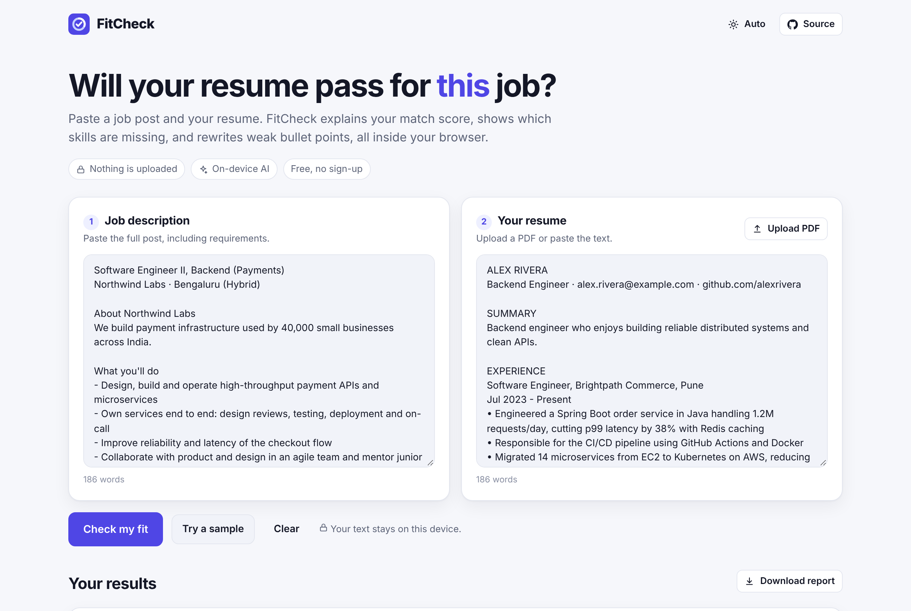
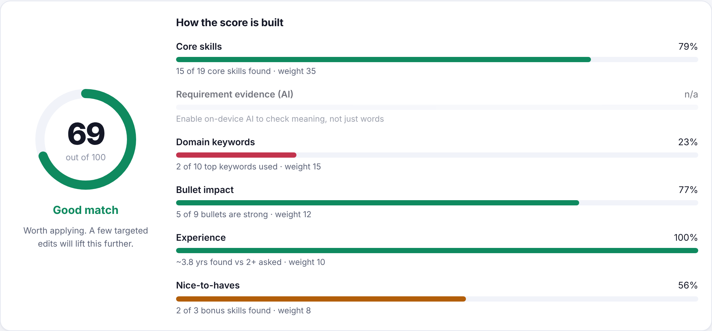
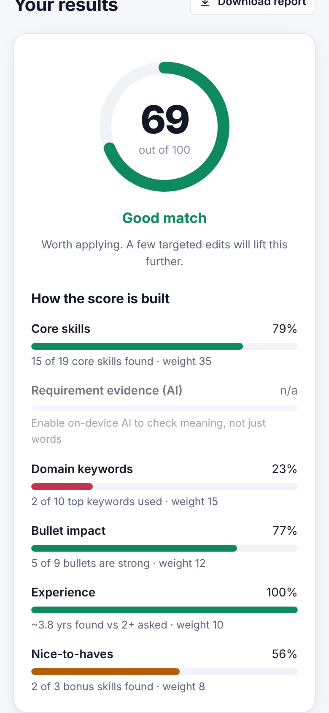
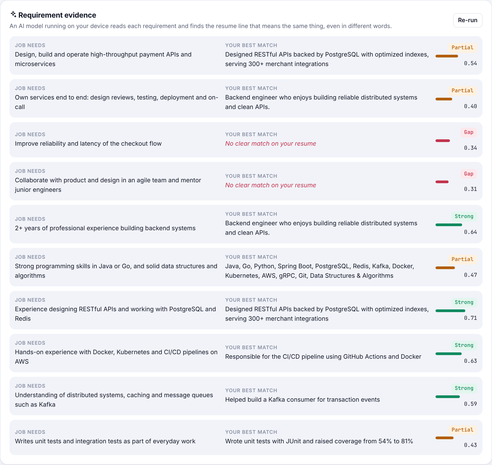
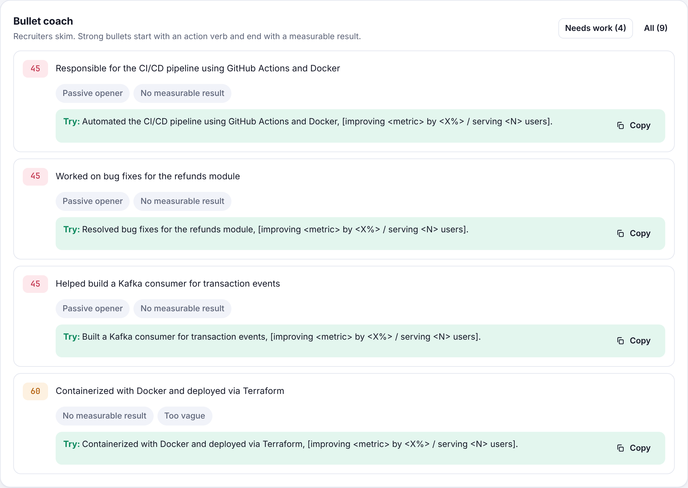
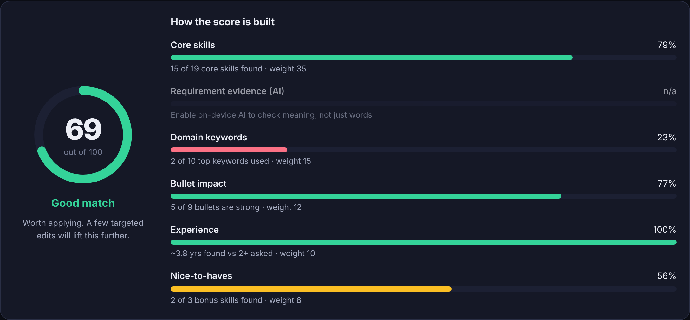
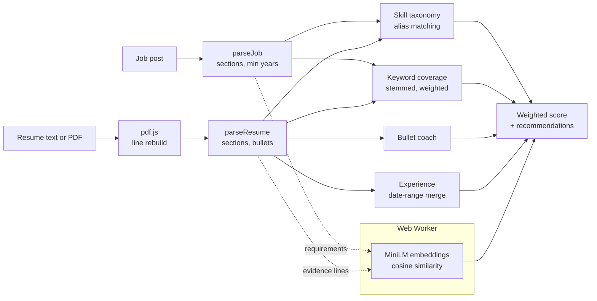

<div align="center">


# FitCheck

**See how well your resume matches a job post, with an explainable score and an AI model that runs on your device.**
**Nothing is uploaded.**

[](https://github.com/dot-hpg/fitcheck/actions/workflows/ci.yml)
[](LICENSE)


[**Live demo**](https://dot-hpg.github.io/fitcheck/) · [How it works](#how-it-works) · [Run locally](#run-locally) · [Deploy](#deploy)



</div>

## Why I built this

Most companies filter resumes with an applicant tracking system (ATS) before a person reads them. Online
"resume scanners" that check this for you usually want an account, an upload of your personal data, and money,
and they give you a number without saying how they got it.

FitCheck does the same job in your browser:

- **Explainable.** Every point of the score comes from a component you can see: skills, evidence, keywords,
  bullet quality and experience.
- **Actionable.** It tells you which skills are missing, which ones you only list without showing, and rewrites
  your weakest bullet points.
- **Private.** Your resume never leaves your device. There is no backend, no account and no tracking. The AI model
  runs locally in a Web Worker.

## Features

| | |
| --- | --- |
| 🎯 **Match score out of 100** | A weighted score with a plain-English verdict and a breakdown of each part. |
| 🧩 **Skill gap analysis** | Detects ~100 skills through 350+ aliases (`k8s` → Kubernetes, `Postgres` → PostgreSQL), and separates core skills from nice-to-haves. |
| 🟡 **"Only listed" detection** | Flags skills that appear in your skills section but never in your experience or projects. Recruiters notice this. |
| ✨ **On-device AI evidence** | A sentence-embedding model (all-MiniLM-L6-v2 via Transformers.js and ONNX Runtime Web) pairs each job requirement with the resume line that means the same thing, even when the words differ. |
| ✍️ **Bullet coach** | Scores every bullet for action verbs, measurable results, length and passive phrasing, then suggests a rewrite. |
| 📄 **PDF upload** | Extracts resume text in the browser with pdf.js, reconstructing reading order from text positions. |
| 📅 **Experience estimate** | Parses date ranges like `Jan 2021 – Present` or `06/2019 - 08/2022`, and merges overlapping roles. |
| ⬇️ **Markdown report** | Download the full analysis to keep alongside your application. |
| 🌗 **Polished UI** | Light and dark themes, works on phones, keyboard-accessible, and remembers your inputs locally. |

## Screenshots

<table>
  <tr>
    <td width="60%"></td>
    <td></td>
  </tr>
  <tr>
    <td colspan="2"></td>
  </tr>
  <tr>
    <td colspan="2"></td>
  </tr>
</table>

<details>
<summary>Dark mode</summary>

</details>

## How it works



The matching engine in [`src/engine`](src/engine) is plain TypeScript with no UI or browser dependencies, so all of
it is unit tested. The pipeline has these parts:

1. **Parsing.** Job posts are split into *required*, *nice-to-have*, *intro* and *info* sections from their headings
   ("Requirements", "Nice to have", "Benefits"…) and inline cues ("…is a plus"). Company blurbs and perks are ignored.
   Resumes are split into sections, and bullets are extracted, including bullets that wrapped onto a second line in
   PDF text.
2. **Skills.** Each skill is compiled into one regex with custom word boundaries, so `C++`, `C#` and `Node.js` match
   while `java` does not match inside `javascript`. Ambiguous names like **Go**, **R**, **C** and **REST** only match
   in their exact case, so "we go the extra mile" doesn't count as Go.
3. **Keywords.** The job post's most repeated domain words are stemmed so "payments" matches "payment". Skill
   names, filler words ("team", "strong") and proper nouns (words that only ever appear capitalised, like company and
   city names) are left out.
4. **Semantic evidence (optional).** Requirement lines and resume lines are embedded with
   `Xenova/all-MiniLM-L6-v2` (quantised, about 23 MB). Each requirement takes its best cosine match and gets a
   Strong (≥ 0.55), Partial (≥ 0.40) or Gap label. The model is cached by the browser after the first download.
5. **Scoring.** Components that have nothing to measure (for example, no stated minimum years) are left out and
   the remaining weights are renormalised. One missing input never drags the score to zero.

| Component | Weight | What it measures |
| --- | ---: | --- |
| Core skills | 35 | Share of required skills found, with skills the post repeats weighted higher |
| Requirement evidence (AI) | 20 | How well resume lines cover each requirement in meaning |
| Domain keywords | 15 | Weighted share of the post's top domain words that you use |
| Bullet impact | 12 | Average bullet quality (verbs, metrics, length, voice) |
| Experience | 10 | Estimated years vs. the stated minimum, capped at 100% |
| Nice-to-haves | 8 | Share of bonus skills found |

### Engineering notes

- **Off the main thread.** Model download and inference run in a Web Worker. A request-id protocol lets
  concurrent calls resolve correctly, and a watchdog fails a stalled download after 60 seconds instead of spinning
  forever.
- **Self-hosted runtime.** The ONNX Runtime WebAssembly files are bundled with the app instead of being loaded
  from a CDN. The only third-party request the app ever makes is the one-time model download from Hugging Face.
- **Lazy loading.** pdf.js (~430 KB) loads only when someone uploads a PDF, and the AI worker only when someone
  runs the AI check. The first page load is about 90 KB of gzipped JavaScript.
- **Stale-result safety.** AI results are tied to the exact text they were computed for. Editing either input
  marks them stale rather than showing outdated evidence.
- **Resilient storage.** `localStorage` access is wrapped so private browsing or blocked storage never breaks the
  app.

## Tech stack

**App:** React 19, TypeScript (strict), Vite<br/>
**AI:** Transformers.js, ONNX Runtime Web (WASM), all-MiniLM-L6-v2<br/>
**PDF:** pdf.js<br/>
**Testing:** Vitest and Testing Library (unit, ~97% engine coverage), Playwright (end to end, including a real-model test)<br/>
**CI/CD:** GitHub Actions: lint (oxlint), typecheck, tests, build, then deploy to GitHub Pages

## Run locally

Requires Node.js 20.19 or newer.

```bash
git clone https://github.com/dot-hpg/fitcheck.git
cd fitcheck
npm install
npm run dev          # http://localhost:5173
```

| Command | What it does |
| --- | --- |
| `npm run dev` | Start the dev server with hot reload |
| `npm test` | Run unit tests |
| `npm run test:coverage` | Unit tests with a coverage report in `coverage/` |
| `npm run test:e2e` | Build, serve and run the Playwright suite (run `npx playwright install chromium` once first) |
| `npm run lint` / `npm run typecheck` | Static checks |
| `npm run build` | Production build in `dist/` |
| `npm run screenshots` | Regenerate the images in `docs/` |

### Testing with the real AI model

Two tests exercise the real embedding model: `src/semantic/embedder.model.test.ts` (Node) and `e2e/ai.spec.ts`
(browser). They run only when `FITCHECK_MODEL_DIR` points at a folder containing the model, so CI stays fast and
offline:

```bash
# Download once (about 115 MB) into ./models/Xenova/all-MiniLM-L6-v2
pip install -U huggingface_hub
hf download Xenova/all-MiniLM-L6-v2 --include "*.json" "onnx/model.onnx" "onnx/model_quantized.onnx" \
  --local-dir models/Xenova/all-MiniLM-L6-v2

FITCHECK_MODEL_DIR=$PWD/models npm test
FITCHECK_MODEL_DIR=$PWD/models npm run test:e2e
```

The browser test serves the files from disk and redirects Hugging Face requests to them, so it checks the full
worker → ONNX Runtime → UI path without network access.

## Deploy

FitCheck is a static site, so it can be hosted free anywhere.

**GitHub Pages (already set up).** In your repository, open **Settings → Pages** and set **Source** to
**GitHub Actions**. Every push to `main` then runs the tests and deploys to
`https://<your-username>.github.io/<repo-name>/`. The workflow sets `BASE_PATH` to the repository name
automatically.

**Vercel.** Import the repository at [vercel.com/new](https://vercel.com/new). It detects Vite; keep the
defaults (`npm run build`, output `dist`).

**Netlify.** Use build command `npm run build` and publish directory `dist`.

**Any static host.** Run `npm run build` and upload `dist/`. If the site lives under a sub-path, build with
`BASE_PATH=/sub-path/ npm run build`.

## Project structure

```
src/
  engine/        Pure TypeScript matching engine (fully unit tested)
    analyze.ts     Orchestrates everything into a scored Analysis
    parse.ts       Job post and resume section parsing
    skills.ts      Skill taxonomy and boundary-aware alias matching
    keywords.ts    Stemmed, weighted keyword coverage
    bullets.ts     Bullet scoring and rewrite suggestions
    experience.ts  Date-range parsing and overlap merging
    semantic.ts    Embedding-based requirement evidence (model injected)
    report.ts      Markdown export
  semantic/      Web Worker, model loading and worker client
  pdf/           In-browser PDF text extraction
  components/    React UI
e2e/             Playwright tests and screenshot generator
```

## Limitations

- The skill taxonomy targets software engineering, data and DevOps roles. Other fields still get keyword,
  bullet and AI analysis, but fewer skill matches.
- Scanned (image-only) PDFs have no text layer. Paste the text instead.
- The score estimates how well your resume matches the post. It does not reproduce any specific company's ATS.

## Roadmap

- [ ] Shareable result links (compressed into the URL hash, still serverless)
- [ ] Taxonomies for more fields (product, design, finance)
- [ ] WebGPU acceleration where available
- [ ] Optional cover-letter outline from the evidence table

## License

[MIT](LICENSE) © 2026 Guntuku Hariprasad
